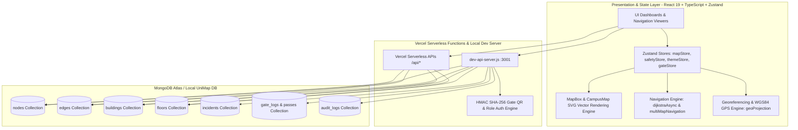
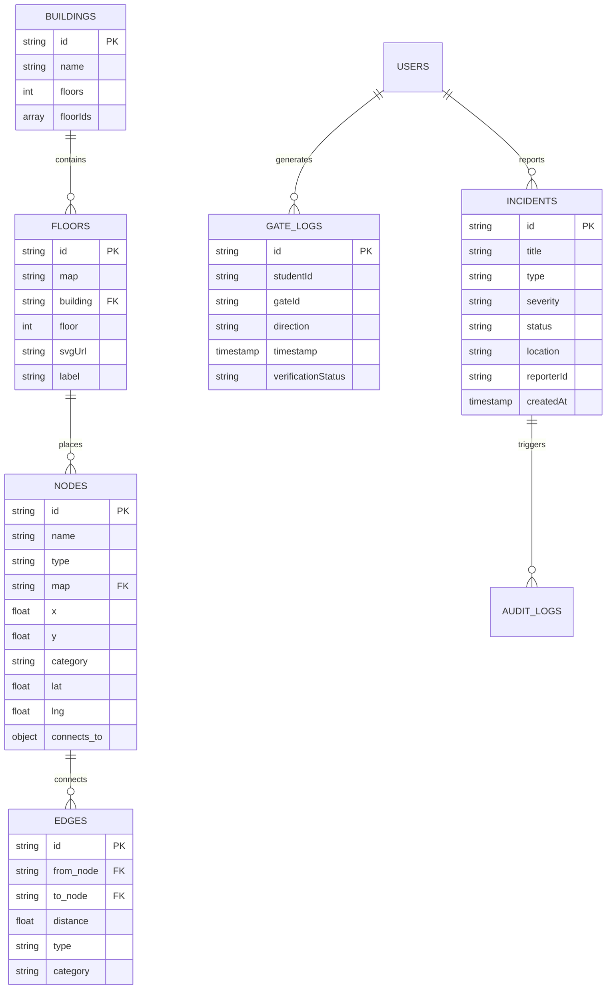
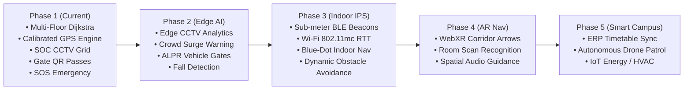

# C3S — Campus Surveillance & Safety System
## Comprehensive System Design, Architecture Documentation, Database Design & Final Submission Report

---

## Executive Summary & Project Identification

| Project Attribute | Details |
|---|---|
| **System Name** | **C3S** (Campus Surveillance & Safety System) with Integrated Navigation Engine |
| **Institution** | **Madhav Institute of Technology & Science (MITS), Gwalior** |
| **Department** | **Department of Mathematics and Computing** |
| **Project Mentor** | **Dr. Dheeraj Kumar Dixit** (Head of Department — Department of Mathematics and Computing) |
| **Core Developers / Partners** | **Abhinav Jaiswal**, **Abhinav Gupta** |
| **System Core Stack** | React 19, TypeScript 6, Vite 8, Zustand, Tailwind CSS, Motion, Node.js, MongoDB, Serverless APIs |
| **Repository Scope** | Multi-Floor Campus Wayfinding, SOC Surveillance, CCTV Telemetry, Gate QR Access Control, SOS Emergency Response |

---

## 1. System Design & Architectural Architecture

### 1.1 Architecture Overview

C3S is built upon a decoupled, resilient, and multi-tier architecture designed for 60 FPS real-time rendering, non-blocking spatial graph calculations, low-latency CCTV video streaming, and rapid incident dispatch.



### 1.2 Core Architectural Principles & Boundaries

1. **Non-Blocking Graph Traversal**:
   - The Dijkstra pathfinding engine (`src/lib/dijkstra.ts`) employs cooperative yielding via `yieldToMainThread` (`requestAnimationFrame` / `setTimeout`), preventing main-thread UI freezing even across dense multi-building graphs.
2. **Multi-Map Spatial Segmentation**:
   - Complex journeys spanning outdoor campus walkways and indoor floor slabs (e.g. Campus Map → AI Ground Floor → AI Third Floor) are assembled into a single unified global graph and segmented into discrete floor steps with transition guidance.
3. **Calibrated Ground Control Georeferencing**:
   - The system synchronizes real-world WGS84 GPS coordinates (latitude, longitude) with the local SVG coordinate space using official MITS campus ground control points (Main Gate, Jubilee Gate, Workshop Gate, Parking Gate).
4. **Resilient Offline-First Fallback Engine**:
   - In environments where backend APIs or MongoDB connections are intermittent, the client seamlessly falls back to pre-seeded local schemas (`src/lib/mock-data/campusDataFallback.json`), guaranteeing uninterrupted critical wayfinding and campus security operations.
5. **Universal Theme-Adaptive Vector Rendering**:
   - All SVG map layers are styled with reactive CSS selectors that respond immediately to the global Light/Dark theme mode.

---

## 2. Database Creation & Schema Specification

The C3S data model is normalized for fast indexed querying, spatial relationships, role-based safety administration, and time-stamped access tracking.

### 2.1 Core Collections & Schema Definitions



#### A. `nodes` Collection
Stores all spatial locations, room numbers, corridors, stairs, lifts, and entrances:
```json
{
  "_id": "ObjectId(...)",
  "id": "room_AI_TF_301_Robotics",
  "name": "AI & Robotics Lab (Room 301)",
  "type": "room",
  "map": "AI_TF",
  "x": 200.0,
  "y": 55.0,
  "category": "lab",
  "lat": 26.23075,
  "lng": 78.20622,
  "connects_to": null
}
```

#### B. `edges` Collection
Defines physical and vertical pathways connecting pairs of nodes:
```json
{
  "_id": "ObjectId(...)",
  "id": "edge_v_ai_st1_sf_tf",
  "from_node": "AI_SF_Stairs01",
  "to_node": "AI_TF_Stairs01",
  "distance": 20.0,
  "type": "stairs",
  "category": "vertical"
}
```

#### C. `buildings` Collection
Maintains campus building hierarchies and available floor levels:
```json
{
  "id": "ai",
  "name": "AI & CSE Building",
  "floors": 4,
  "floorIds": ["AI_GF", "AI_FF", "AI_SF", "AI_TF"]
}
```

#### D. `floors` Collection
Binds floor levels to their corresponding vector SVGs and labels:
```json
{
  "id": "floor_campus_ai_tf",
  "map": "AI_TF",
  "building": "ai",
  "floor": 3,
  "svgUrl": "/maps/AI_TF.svg",
  "label": "AI Building — Floor 3"
}
```

#### E. `incidents` Collection
Tracks SOS alarms, safety dispatches, and emergency reports:
```json
{
  "id": "INC-2026-9042",
  "title": "Medical Emergency at AI Complex F3",
  "type": "MEDICAL",
  "severity": "CRITICAL",
  "status": "EN_ROUTE",
  "map": "AI_TF",
  "x": 200.0,
  "y": 55.0,
  "reporterId": "STU-2024-8891",
  "assignedResponder": "RESP-04",
  "createdAt": "2026-10-31T00:54:12Z"
}
```

#### F. `gate_logs` & `gate_passes` Collections
Logs digital student ID verifications, QR passes, and entry/exit turnstile records.

---

## 3. Module Development & Component Breakdown

### Module 1: Pathfinding & Navigation Core (`src/lib/`, `src/hooks/`)
- **`dijkstraAsync` (`src/lib/dijkstra.ts`)**: Custom min-priority queue algorithm using non-blocking asynchronous yielding to prevent UI frame drops.
- **`buildGlobalGraph` (`src/lib/multiMapNavigation.ts`)**: Converts discrete floor maps and outdoor campus vectors into an interconnected multi-layer graph with bidirectional edges.
- **`segmentPathByMap`**: Decomposes calculated path node sequences into actionable multi-floor steps with floor transitions.
- **`geoProjection.ts`**: Calibrated mathematical coordinate transformation between real-world WGS84 GPS (lat/lon) and SVG vector (x/y) coordinates.
- **`useCampusNavigation.tsx`**: Central React context hook managing route requests, live GPS tracking, 1-click current location acquisition, turn guidance, and compass heading.

### Module 2: Interactive Vector Map Canvas (`src/components/ui/`, `public/maps/`)
- **`MapBox.tsx`**: High-performance interactive SVG viewport supporting smooth pan, gesture zoom, auto-fit, GPS accuracy halo, animated polyline route paths, and real-time responder pucks.
- **`Campus_Map.svg`**: Architectural master map of MITS Gwalior featuring:
  - Main Academic Building with Central Atrium
  - AI & CSE Complex
  - Central Library
  - Workshops & Mechanical Complex
  - Electrical Engineering Department
  - Student Canteen & SAC
  - Student Hostels & Residences
  - Open Gym & Fitness Zone
  - Campus Gates 1, 2, 3, and 4
- **Floor Maps (`AI_GF.svg`, `AI_FF.svg`, `AI_SF.svg`, `AI_TF.svg`, `Main_GF.svg`, `Main_FF.svg`, `Main_SF.svg`)**: Multi-floor vector maps with exact room geometries and stair/lift connections.
- **`NodeDetailDrawer.tsx`**: Glassmorphic node card displaying room specifications, walking distance estimates, and 1-tap navigation buttons.

### Module 3: Security Operations Center (SOC) & CCTV Surveillance
- **`CctvSocDashboard.tsx` & `CCTVGrid.tsx`**: Real-time multi-camera grid monitoring camera feeds across MITS campus gates, academic foyers, and perimeter zones.
- **`LiveDetectionOverlay.tsx`**: Real-time computer vision simulation identifying student movement, density heatmaps, and bounding boxes.
- **`CameraDetailModal.tsx`**: Deep camera telemetry with PTZ controls, crowd headcount, stream health, and snapshot export.

### Module 4: Incident Response & Emergency SOS Broadcasting
- **`SosModal.tsx` & `SOSButton.tsx`**: High-priority SOS broadcast trigger transmitting student GPS/room coordinates directly to security dispatch.
- **`ControlRoomDashboard.tsx`**: Control room command center featuring incident triage queues, responder fleet availability, and real-time status progression (NEW → ACKNOWLEDGED → EN_ROUTE → ON_SCENE → RESOLVED).
- **`SecurityDashboard.tsx`**: Field officer terminal for quick patrol response and incident resolution.

### Module 5: Gate Security & Turnstile QR Access Control
- **`GateKeeperDashboard.tsx`**: Gatekeeper scanning console for entry/exit gates.
- **`GateQRDisplay.tsx` & `QRScanner.tsx`**: Cryptographically signed HMAC SHA-256 rotating QR passes for automated, contact-free campus entry.
- **`GateMapOverlay.tsx`**: Real-time visual overlay on the master campus map indicating live gate ingress/egress volume and occupancy.

### Module 6: Role-Based User Portals & UI Architecture
- **`StudentDashboard.tsx`**: Personal student safety companion featuring digital ID card, quick SOS trigger, pass status, and recent activity.
- **`AdminDashboard.tsx`**: System-wide analytics, user management, audit trails, and infrastructure telemetry.
- **`DevelopersPage.tsx`**: Dedicated project showcase honoring faculty mentorship and developer credits.

---

## 4. Documentation & Final Submission Dossier

### 4.1 Project Metadata & Mentorship Details

- **Academic Institution**: Madhav Institute of Technology & Science (MITS), Gwalior (M.P.), India
- **Department**: Department of Mathematics and Computing
- **Project Mentor**:
  - **Dr. Dheeraj Kumar Dixit**
  - *Head of Department (HOD)* — Department of Mathematics and Computing
  - [Official Faculty Profile](https://web.mitsgwalior.in/faculty-profiles-emc-2/dr-dheeraj-kumar-dixit)
- **Partners & Student Developers**:
  - **Abhinav Jaiswal** — Architecture, Navigation Engine & Frontend Engineering
  - **Abhinav Gupta** — Security Systems, Database Architecture & API Development

### 4.2 System Name & Brand Consistency Compliance
All legacy designations (e.g. UniMap, dotrwt) have been completely removed and systematically unified under **C3S** (Campus Surveillance & Safety System) across:
- Application HTML headers, titles, meta tags, and Web App Manifest
- High-resolution favicon and SVG brand assets (`/assets/c3s_logo.png`)
- Serverless API endpoints, environment variables, and CLI utilities
- UI navigation drawers, topbars, footers, and modal titles

### 4.3 Key Milestones & Functional Verification

| Milestone | Status | Description |
|---|---|---|
| **Dijkstra Multi-Floor Pathfinding** | **Verified** | Asynchronous routing across Campus master and multi-floor buildings with step-free accessibility support. |
| **GPS Georeferencing & 1-Click Current Location** | **Verified** | Live browser geolocation projected to SVG canvas via MITS ground control coordinates with graceful gate fallback. |
| **AI Building Floor 3 (F3) Extension** | **Verified** | Integrated Floor 3 (`AI_TF`) into database, floor selector tabs, multi-floor stairs/lift graph, and vector maps. |
| **Clean Architectural Map Redesign** | **Verified** | High-contrast, minimal SVG map with Open Gym, clean lawns, accurate building footprints, and 0 unnecessary clutter. |
| **Dual Theme Glassmorphism** | **Verified** | Full light/dark mode support across all screens, drawers, cards, and SVG map layers. |
| **Zero-Error Production Build** | **Verified** | Validated via `npm run build` (`tsc -b && vite build`) with 100% clean compilation. |

---

## 5. Future Phases, Expansion Roadmap & Research Scopes

The C3S architecture is designed with modular microservices and standardized graph interfaces, providing a robust foundation for next-generation smart campus expansion across safety, surveillance, and automated spatial computing.



### 5.1 Phase 2: Edge AI Computer Vision & Automated Video Analytics
- **On-Device Edge Neural Inference**:
  - Deploy lightweight YOLOv11 / RT-DETR models on edge gateways (NVIDIA Jetson / Intel NPU) directly adjacent to campus CCTV camera nodes.
  - **Automated Incident Flagging**: Continuous background detection of unattended bags, unauthorized after-hours perimeter crossing, and slip-and-fall incidents in stairwells.
- **Crowd Surge & Stampede Early Warning**:
  - Real-time density heatmaps and optical flow vector tracking during major campus symposiums, colloquiums, and festivals to alert the Control Room SOC before localized bottlenecks become hazardous.
- **Automated License Plate Recognition (ALPR)**:
  - Computer vision vehicle registration at Gate 1 (Main Gate) and Gate 2 (Parking Gate), cross-referencing staff/student vehicle permits with boom barrier controllers.

### 5.2 Phase 3: High-Precision Sub-Meter Indoor Positioning (IPS)
- **BLE 5.3 AoA (Angle of Arrival) Beacon Mesh**:
  - Install low-power Bluetooth Low Energy beacons along corridors and stairwells in the Main Academic Building and AI & CSE Complex.
  - Achieves sub-meter (0.5m – 1m) "blue-dot" indoor positioning without requiring line-of-sight satellite GPS signals.
- **Wi-Fi 802.11mc / FTM (Fine Timing Measurement)**:
  - Leverage campus enterprise Wi-Fi 6 access points for hardware-level Round Trip Time (RTT) multilateration.
- **Dynamic Real-Time Obstacle Re-Routing**:
  - Allow campus maintenance crews or safety officers to mark temporary floor closures, wet surfaces, or renovation work in real time, with the Dijkstra pathfinding engine recalculating accessible alternative routes immediately.

### 5.3 Phase 4: Augmented Reality (AR) Wayfinding & Spatial Computing
- **Browser-Based WebXR / ARCore Camera View**:
  - Students and campus visitors can point their smartphone cameras down corridors to see live floating 3D navigation paths and holographic directional arrows projected onto the physical floor.
- **Point-and-Identify Lens**:
  - Real-time computer vision recognition of department nameplates, laboratory doors, and faculty cabins displaying interactive metadata (faculty consultation hours, room occupancy, equipment list) directly in the camera viewfinder.
- **Spatial Audio Guidance**:
  - 3D spatialized voice instructions (e.g. "Turn right into the AI Lab in 5 meters") tailored for visually impaired students.

### 5.4 Phase 5: Autonomous Security Drone Patrols & First Responder Fleet
- **Rapid Aerial SOS Verification**:
  - Integration with automated rooftop drone docks. When a critical SOS alert is broadcast from an open ground or parking zone, an autonomous drone flies to the exact GPS coordinates within 45 seconds to deliver live aerial video telemetry to the SOC.
- **Automated Guard Route Optimization**:
  - Algorithmic dispatch that computes the shortest multi-floor path for the nearest on-duty security guard to reach an incident location, providing them with turn-by-turn guidance and room layout previews on their mobile terminal.

### 5.5 Phase 6: Academic ERP, Student Timetable & LMS Integration
- **Automated "Find My Next Class" Scheduling**:
  - Two-way API sync with the MITS Academic ERP. 10 minutes prior to a scheduled lecture or lab session, students receive a smart notification with a 1-tap navigation button leading directly to their assigned classroom or lab bench.
- **Automated Geo-Fenced Attendance Verification**:
  - Seamless contactless lecture attendance logging authenticated via turnstile gate scans and indoor room proximity verification.

### 5.6 Phase 7: Smart Building IoT & Environmental Sustainability
- **Occupancy-Driven Energy Optimization**:
  - Telemetry from C3S CCTV crowd density algorithms feeds directly into building management systems (BMS) to automatically power down lighting, projector equipment, and air conditioning units in vacant classrooms and lecture halls.
- **Campus Environmental Telemetry**:
  - Integration with ambient environmental sensors measuring air quality (AQI), temperature, ambient noise, and natural illumination across campus outdoor pavilions.

---

## 6. Deployment & Execution Instructions

### Local Development Setup

1. **Clone & Install Dependencies**:
   ```bash
   git clone <repo-url>
   cd campussurvillence
   npm install
   ```

2. **Run MongoDB Dev API Server**:
   ```bash
   node dev-api-server.js
   ```

3. **Start Vite Development Client**:
   ```bash
   npm run dev
   ```

4. **Compile Production Build**:
   ```bash
   npm run build
   ```

5. **Preview Production Bundle**:
   ```bash
   npm run preview
   ```

---

*C3S (Campus Surveillance & Safety System) — Designed and Developed at Madhav Institute of Technology & Science (MITS), Gwalior.*

