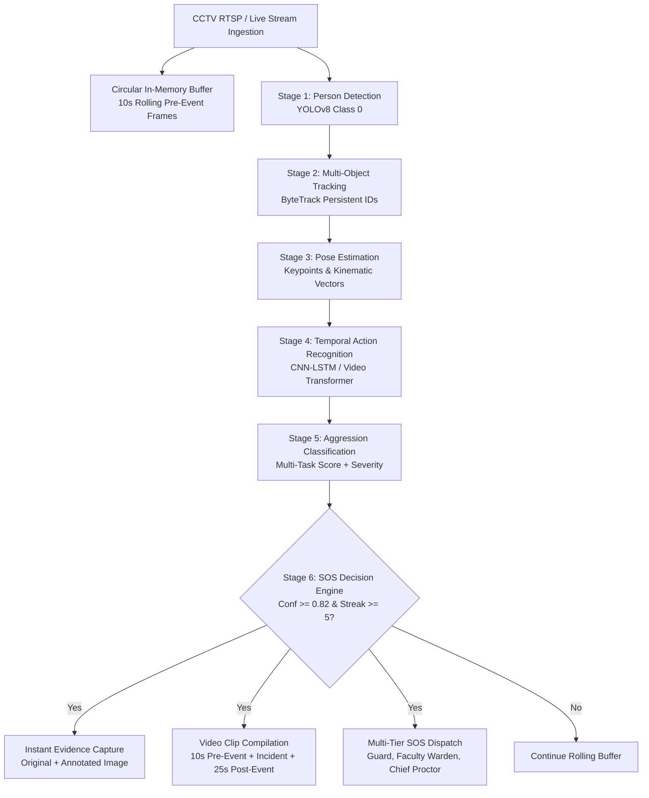

# AI-Powered Aggression, Violence & Fight Detection with Automatic SOS and Evidence Capture

[](#3-multi-stage-computer-vision-architecture)
[](#4-model-architectures)
[](#6-automatic-sos--evidence-capture)
[](#7-backend--database-architecture)

---

## 1. Project Objective

An enterprise-grade, real-time AI video surveillance and emergency dispatch system designed for campus safety, high-risk security sectors, and public facilities. 

The system analyzes continuous CCTV RTSP streams, recognizes aggressive behaviors and physical altercations across 14 fine-grained categories, calculates calibrated aggression scores, and automatically triggers multi-tier emergency SOS dispatches with pre-event and post-event video and watermarked image evidence.

---

## 2. Detection Categories & Bias Mitigation

### Action Categories (14 Classes)
1. **Normal Interaction** (Conversations, walking, sitting)
2. **Verbal Aggression** (Flagged only if authenticated audio stream is attached)
3. **Aggressive Gestures** (Chest puffing, fist clenching, pointing threateningly)
4. **Pushing and Shoving** (Two-handed impact shoves)
5. **Punching** (Jabs, crosses, hooks, rapid arm extension strikes)
6. **Kicking** (Front kicks, side strikes, high leg extensions)
7. **Slapping** (Open-handed rapid strikes)
8. **Physical Fighting** (Two-person grappling, striking, and wrestling)
9. **Multiple-Person Fighting** (Brawls involving 3+ combatants)
10. **Chasing and Attacking** (High-velocity pursuit with physical strikes)
11. **Physical Assault** (One-sided physical attack against a non-retaliating victim)
12. **Crowd Aggression** (Surging aggressive clusters, mob violence)
13. **Person Falling During an Altercation** (Knockdowns, takedowns, collapse)
14. **Potential Weapon-Related Threats** (Visual evidence of bludgeons/weapons)

### Strict Anti-Bias Rules & Benign Activity Discrimination
The model explicitly discriminates between violent physical altercations and normal physical activities:
- **Handshakes & Friendly Hugs**
- **Sports & Recreational Activities** (Basketball, soccer, running)
- **Dancing & Playful Bumps**
- **Accidental Collisions**

> [!IMPORTANT]
> The system **never** classifies individuals based on facial appearance, clothing, skin color, gender, or demographic traits. All classifications operate strictly on spatial-temporal motion dynamics, pose kinematics, and interpersonal collision energy.

---

## 3. Multi-Stage Computer Vision Architecture



1. **Stage 1: Person Detection (`vision/person_detector.py`)**: Localizes human subjects, filtering out background motion and environmental noise.
2. **Stage 2: Multi-Object Tracking (`vision/multi_tracker.py`)**: Assigns persistent tracking IDs using IoU and Kalman association to preserve subject identities across violent collisions and occlusions.
3. **Stage 3: Pose Estimation (`vision/pose_estimator.py`)**: Computes joint velocities (wrist strike speeds for punches, ankle strike speeds for kicks, and hip downward velocity for knockdowns).
4. **Stage 4: Action Recognition (`models/cnn_lstm.py` / `models/video_transformer.py`)**: Evaluates temporal sequences of 16 frames to identify motion trajectories rather than isolated snapshots.
5. **Stage 5: Aggression Classification**: Produces a calibrated probability ($0.0 \dots 1.0$) with exponential moving average temporal smoothing to eliminate transient spikes.
6. **Stage 6: SOS Decision Engine (`engine/decision_engine.py`)**: Enforces multi-frame persistence, minimum severity thresholds, and automatic cooldown debounce to avoid repeated spam.

---

## 4. Model Architectures & Training Pipeline

### A. Spatio-Temporal CNN-BiLSTM (`models/cnn_lstm.py`)
- **Spatial Backbone**: Deep 2D convolutional feature extractor yielding 256-dimensional spatial representations.
- **Pose Kinematics Stream**: Multi-layer perceptron mapping 17 body keypoint displacement vectors.
- **BiLSTM Temporal Core**: Bidirectional LSTM modeling forward and backward time steps.
- **Temporal Attention**: Multi-Head Self-Attention attending to explosive strike and knockdown moments.

### B. Spatio-Temporal Video Transformer (`models/video_transformer.py`)
- **3D Tubelet Projection**: Tokenizes video sequences across space and time simultaneously.
- **Transformer Encoder**: 4-layer multi-head self-attention with GELU feedforward layers.

### C. Class-Balanced Loss (`models/loss.py`)
Calculates effective number of samples $E_n = \frac{1 - \beta^n}{1 - \beta}$ combined with multi-class Focal Loss:
$$\text{FL}(p_t) = -\alpha_t (1 - p_t)^\gamma \log(p_t)$$
This focuses gradient updates on rare violent altercation clips while down-weighting abundant normal pedestrian frames.

### Training Command
```bash
python -m ai_surveillance.training.train --model cnn_lstm --epochs 30 --batch_size 8 --lr 0.0003
```

---

## 5. Performance & Evaluation Benchmarking

Run genuine model benchmarking without hardcoded claims:
```bash
python -m ai_surveillance.training.evaluate --model cnn_lstm
```
Computes:
- **Precision, Recall, and F1-Score** per category
- **False Positive Rate (FPR)** and **False Negative Rate (FNR)**
- **Mean & P95 Inference Latency (ms)**
- **Throughput (FPS)** on CPU and CUDA

---

## 6. Automatic SOS & Evidence Capture

### A. Instant Forensic Snapshot
- **Raw Image**: Unmodified sensor frame at exact detection timestamp.
- **Annotated Image**: HUD overlay displaying detected bounding boxes, tracking IDs, threat classification, camera ID, and location watermark.
- **SHA-256 Checksum**: Cryptographic hash generated at capture time to guarantee chain of custody.

### B. Pre-Event & Post-Event Rolling Circular Buffer (`vision/circular_buffer.py`)
- Automatically buffers **10 seconds before the altercation begins**.
- Records continuously through the incident and for **25 seconds post-event**.
- Automatically encodes to MP4 format and computes tamper-evident file hashes.

---

## 7. Backend & Database Architecture

### PostgreSQL DDL (`backend/database/schema.sql`)
- `cameras`: CCTV stream source, zone, coordinates, online status.
- `incidents`: Unique incident ID, predicted category, severity, confidence, duration, review status.
- `evidence_records`: File paths, byte sizes, SHA-256 hashes, pre/post buffer durations.
- `incident_audit_logs`: Tamper-proof log of every operator confirmation, resolution, and evidence download.

### REST Endpoints
| Method | Path | Description |
|---|---|---|
| `GET` | `/api/incidents/` | Filtered list of detected incidents |
| `GET` | `/api/incidents/{id}` | Incident details with evidence files & audit trail |
| `POST` | `/api/incidents/{id}/confirm` | Confirm detected physical altercation |
| `POST` | `/api/incidents/{id}/false-positive` | Flag false positive with operator notes |
| `POST` | `/api/incidents/{id}/resolve` | Resolve incident following security intervention |
| `GET` | `/api/incidents/{id}/report` | Export forensic report |
| `GET` | `/api/cameras/` | List CCTV cameras & stream health |
| `WS` | `/ws/alerts` | Real-time WebSocket incident and telemetry streaming |

---

## 8. Deployment Quick Start

### Option 1: Docker Compose (Recommended)
```bash
cd ai_surveillance
docker-compose up --build -d
```
Starts:
- PostgreSQL database on port `5432` with preloaded schema
- Redis event broker on port `6379`
- FastAPI & WebSocket surveillance server on port `8000`

### Option 2: Local Python Execution
```bash
# 1. Install dependencies
pip install -r ai_surveillance/requirements.txt

# 2. Run unit tests
python -m unittest discover -s ai_surveillance/tests

# 3. Launch FastAPI backend
python -m uvicorn ai_surveillance.backend.main:app --host 0.0.0.0 --port 8000 --reload
```

